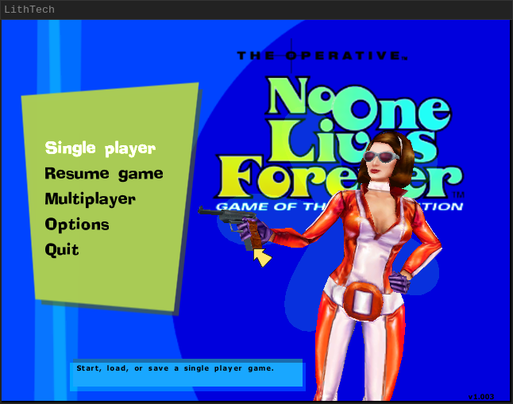
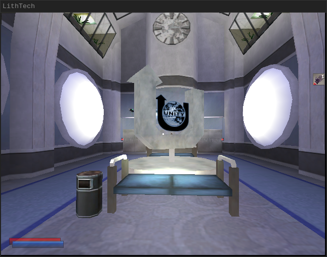

# No One Lives Forever, built from source

Source code and a build for **The Operative: No One Lives Forever** (Game of
the Year Edition, PC, 2000/2001): every executable and DLL of the game --
the LithTech engine (`lithtech.exe`, `server.dll`, the Direct3D renderer
`d3d.ren`), the `NOLF.exe` launcher, `ltmsg.dll`, `sres.dll` and the three game
DLLs -- compiled from the source in this repository with the original
2000-era compilers.

<p align="center">
  
  
</p>

The engine source in `src/engine/` is a reconstruction: Monolith never
released it, so it was written to recompile to the retail machine code. The
game code in `src/game/` is Monolith's own NOLF Source Code v1.003 release,
which predates the Game of the Year Edition: the GOTY changes to it,
reconstructed from the retail GOTY game DLLs, are made in place and marked
`GOTY:`, and the modern build's changes sit inside `#ifdef NOLFSRC_MODERN`
blocks. See `LICENSE-NOTES.md` for what is whose.

This project, and its modern build in particular, is not made or supported by
Monolith Productions.

**No game data is included.** The build takes the game's data (and the Miles
and Bink sound/video runtime, the only binaries not built from source) from
the retail Game of the Year Edition, which the `rez/` submodule installs from
the redump images of its two discs, fetched from archive.org. The modern
build replaces that runtime with open-source builds from `ext/`: OpenMiles
for Miles, and our own Bink player on FFmpeg.

## Roadmap

1. **Byte-for-byte compatibility, for preservation.** Every binary compiles
   to exactly the machine code that shipped, so this source is a faithful
   record of the game as released. The whole game already builds from this
   source and plays; how much of it already compiles to the retail bytes is
   under [Progress](#progress). The rest is written and working, but not yet
   identical.
2. **Integrate the [NOLF Modernizer](https://haekb.itch.io/nolf-modernizer)
   patch**, so its improvements are part of the source rather than a patch
   applied on top.
3. **Fix the bugs found during reverse engineering.** Rebuilding the engine
   to the exact bytes means reproducing its original bugs as well; once the
   byte-exact version is preserved, the fixes can go on top of it. The bugs
   found so far are listed in [`RETAIL_BUGS.md`](RETAIL_BUGS.md). Fixes go
   behind the `NOLFSRC_MODERN` define and are built by `make modern`, so the
   release build keeps matching the retail one.
4. **Move the renderer from Direct3D 7 to Vulkan**, for native play on every
   platform, without Wine.

## Progress

How much of each binary compiles to exactly the bytes of the retail game
(the Game of the Year Edition, version 1.003). A function counts when our
compiled code is identical to the retail function, with only the addresses
the linker fills in left out of the comparison; the bars measure the share
of each binary's code, by size, those functions make up.

<!-- progress:begin -->
<!-- generated by tools/ratchet.py from progress/summary.json: edit neither by hand; `make progress-update` rewrites both -->

| Binary | | Byte-identical functions | Byte-identical code | | Unwritten | Unplaced |
|---|---|--:|--:|---|--:|--:|
| `lithtech.exe` | the engine | 3,042 / 3,432 | 442,993 / 571,030 bytes | `███████████████░░░░░` 77.5% | 0 | 12 |
| `server.dll` | the server | 2,031 / 2,272 | 212,941 / 249,622 bytes | `█████████████████░░░` 85.3% | 0 | 4 |
| `d3d.ren` | the Direct3D renderer | 750 / 944 | 134,188 / 515,553 bytes | `█████░░░░░░░░░░░░░░░` 26.0% | 0 | 15 |
| `NOLF.exe` | the launcher | 172 / 221 | 34,056 / 35,033 bytes | `███████████████████░` 97.2% | 0 | 0 |
| lithshared | the shared libraries | 807 / 812 | 96,039 / 98,226 bytes | `███████████████████░` 97.7% | 0 | 0 |
| `CShell.dll` | the game: client | 3,715 / 4,928 | 914,920 / 933,114 bytes | `███████████████████░` 98.0% | 0 | 0 |
| `Object.lto` | the game: server objects | 4,885 / 6,919 | 1,239,233 / 1,261,040 bytes | `███████████████████░` 98.2% | 0 | 0 |
| `CRes.dll` | the game's resources, not in the total | 411 / 411 resources | 704,745 / 704,745 bytes | `████████████████████` 100.0% | 0 | -- |
| **All** | | **15,402 / 19,528** | **3,074,370 / 3,663,618 bytes** | `████████████████░░░░` **83.9%** | **0** | **31** |
<!-- progress:end -->

Every function in that table is recorded in `progress/identical.txt`, and
`make progress` re-scores the current build against the retail binaries and
fails if any of them stops matching. See `progress/README.md` for how the
scoring works and how to run it. The GameSpy library linked into the game
DLLs is third-party middleware and is not scored, and neither are the
resource-only `ltmsg.dll` and `sres.dll` yet.

## Build

You need Linux with Docker and the submodules:

1. Fetch them: `git submodule update --init` (or clone with
   `--recurse-submodules`). `toolchains/` is the compilers (about 560 MB,
   see `toolchains/README.md`); `rez/` fetches and installs the retail game
   (see `rez/README.md`); `ext/openmiles` and `ext/ffmpeg` are the modern
   build's open-source middleware (about 130 MB).
2. Run

```sh
make            # -> out/nolf-legacy-release/ and out/nolf-legacy-release.tar.gz
                #    (about 3 minutes; the first time, also the docker image
                #    and the retail game's download and install)
make test       # optional: plays two levels under Xvfb with scripted input
make debug      # optional: the same game with symbols and debug logging,
                #    in out/nolf-legacy-debug/
make modern     # optional: the game with the retail bugs fixed, in
                #    out/nolf-modern-release/ (both: BUILDING.md, "Variant builds")
make progress   # optional: how much of it matches the retail binaries
```

`make help` lists the other targets. `BUILDING.md` explains the build in
detail.

## Play

`out/nolf-legacy-release/` is a complete game directory. On a Linux machine with Wine
(32-bit support needed):

```sh
out/nolf-legacy-release/linux-run.sh                # windowed, 640x480
out/nolf-legacy-release/linux-run.sh --res 1024x768
out/nolf-legacy-release/linux-run.sh --world 'Worlds\T01S01'
```

To play elsewhere, copy `out/nolf-legacy-release.tar.gz` (one file), unpack it
and run `nolf-legacy-release/linux-run.sh`. Every variant is packaged the same way:
`out/nolf-legacy-debug.tar.gz`, `out/nolf-modern-release.tar.gz` and
`out/nolf-modern-debug.tar.gz`. `nolf-legacy-release/linux-run-launcher.sh` starts the game through the
`NOLF.exe` launcher instead. Both scripts document their options in their
headers. Sound needs Wine's audio to work on that machine.

Music needs more in the release build: it is DirectMusic, which Wine
implements only in part. Its own DirectMusic cannot load the music's styles,
so the game plays in silence apart from the sound effects. The modern build
carries Microsoft's DirectMusic in its game directory and needs nothing
installed, in Wine or in Proton (a Steam Deck included;
`src/modern/directmusic/README.md`). For the release build, install
Microsoft's DirectMusic into the Wine prefix the game runs in
(`linux-run.sh` uses `~/.wine-nolf`):

```sh
WINEPREFIX=~/.wine-nolf winetricks dmband dmcompos dmime dmloader dmscript \
    dmstyle dmsynth dmusic dmusic32 dswave gmdls
```

Not winetricks' `directmusic` verb: it also replaces Wine's DirectSound with
Microsoft's, which the sound effects play through, and they then repeat. If
it is already installed, give DirectSound back to Wine:
`WINEPREFIX=~/.wine-nolf wine reg delete 'HKCU\Software\Wine\DllOverrides' /v dsound /f`.

On a Steam Deck (or any Steam with Proton), the modern build needs no
winetricks or Protontricks: unpack `nolf-modern-release.tar.gz`, add its
`NOLF.exe` as a non-Steam game (Desktop Mode, Steam > Games > Add a
Non-Steam Game), and in the shortcut's Properties > Compatibility force a
Proton version. The music plays from the game directory's own DirectMusic.
(Checked under Wine 9.0; the Proton steps are untested here.)

## Contributing

The remaining work is functions that are written but not yet byte-identical,
and functions not written yet. `guides/` explains the method, from reading the
retail machine code to the compiler quirks that decide the last few bytes;
`make progress` (after `make`) shows where things stand and catches a change
that breaks a function that matched before.

## Layout

| Path | What |
|---|---|
| `src/engine/` | the engine, launcher and resource DLLs (reconstructed source) |
| `src/lithshared/` | the LithTech shared static libraries the engine and game link |
| `src/game/` | Monolith's NOLF Source Code v1.003 (client, server and resource DLLs) |
| `src/LT2/` | the LithTech SDK and shared-library headers from the same release |
| `build/` | the build scripts (`all.sh` is the whole build) |
| `tools/` | the build's helpers, the playtest, and the tools for reading the retail code and comparing ours with it |
| `guides/` | how to reconstruct a function so it compiles to the retail bytes: start here to contribute |
| `progress/` | the record of what is byte-identical so far, and what `make progress` checks against it |
| `docker/` | the build image (Ubuntu 24.04 + Wine) |
| `toolchains/` | the compilers (a submodule) |
| `rez/` | the retail game the build takes its data from: fetches the disc images and installs the game from them (a submodule) |
| `ext/` | upstream open-source projects the modern build uses, one submodule each: `openmiles/` (OpenMiles, for Miles) and `ffmpeg/` (FFmpeg, for Bink); built by `build/ext.sh`, with our fixes from `ext/patches/` |
| `out/` | everything the build produces |
